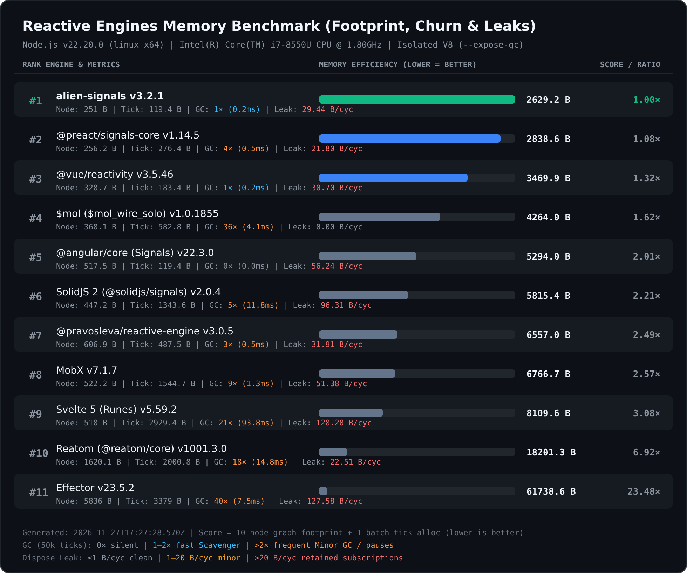

# reactive-memory-benchmark

Воспроизводимый бенчмарк потребления памяти, давления на сборщик мусора V8 (Young Generation) и утечек при динамическом монтировании/уничтожении графа для **Реактивных движков** в изолированных процессах Node.js (`--expose-gc`).



## 1. Результаты последнего прогона

* **Дата замера:** `2026-11-27T17:27:28.570Z`
* **Среда выполнения:** Node.js `v22.20.0` (`linux x64`), `Intel(R) Core(TM) i7-8550U CPU @ 1.80GHz`
* **Масштаб тестов:** `10 000` узлов (Footprint) | `5 000` тиков (Churn) | `2 000` циклов mount/dispose (Leaks)

| Rank | Engine | Node (B) | Tick Alloc (B) | Minor GC | GC Pause (ms) | Leak (B/cycle) | Memory Score (B) | Ratio |
| :---: | :--- | :---: | :---: | :---: | :---: | :---: | :---: | :---: |
| **1** | **alien-signals `v3.2.1`** | `251` | `119.4` | `1×` | `0.18` | `29.44` | `2629.2` | `1.00×` |
| **2** | @preact/signals-core `v1.14.5` | `256.2` | `276.4` | `4×` | `0.48` | `21.80` | `2838.6` | `1.08×` |
| **3** | @vue/reactivity `v3.5.46` | `328.7` | `183.4` | `1×` | `0.16` | `30.70` | `3469.9` | `1.32×` |
| **4** | $mol ($mol_wire_solo) `v1.0.1855` | `368.1` | `582.8` | `36×` | `4.14` | `0.00` | `4264` | `1.62×` |
| **5** | @angular/core (Signals) `v22.3.0` | `517.5` | `119.4` | `0×` | `0.00` | `56.24` | `5294` | `2.01×` |
| **6** | SolidJS 2 (@solidjs/signals) `v2.0.4` | `447.2` | `1343.6` | `5×` | `11.85` | `96.31` | `5815.4` | `2.21×` |
| **7** | @pravosleva/reactive-engine `v3.0.5` | `606.9` | `487.5` | `3×` | `0.45` | `31.91` | `6557` | `2.49×` |
| **8** | MobX `v7.1.7` | `522.2` | `1544.7` | `9×` | `1.33` | `51.38` | `6766.7` | `2.57×` |
| **9** | Svelte 5 (Runes) `v5.59.2` | `518` | `2929.4` | `21×` | `93.77` | `128.20` | `8109.6` | `3.08×` |
| **10** | Reatom (@reatom/core) `v1001.3.0` | `1620.1` | `2000.8` | `18×` | `14.76` | `22.51` | `18201.3` | `6.92×` |
| **11** | Effector `v23.5.2` | `5836` | `3379` | `40×` | `7.55` | `127.58` | `61738.6` | `23.48×` |

## 2. Методология и устройство тестов

```text
================================================================================
  ТОПОЛОГИЯ ТЕСТОВ ПАМЯТИ (3 НЕЗАВИСИМЫХ СЦЕНАРИЯ В ИЗОЛИРОВАННЫХ V8-ПРОЦЕССАХ)
================================================================================

  Обозначения:
    S(x)     — сигнал-источник (source)
    C(x)     — вычисляемый узел (computed)
    E(eff)   — эффект-наблюдатель (effect)
    ─→       — ребро зависимости (потребитель читает источник)
    ──X      — вызов dispose() / отписка и удаление ребра

  ------------------------------------------------------------------------------
  1. GRAPH FOOTPRINT — статический вес одного узла [ Node (B) ]
     Масштаб: 2 500 цепочек × 4 узла = 10 000 узлов в куче одновременно

       S(s) ─→ C(c1) ─→ C(c2) ─→ E(eff)   (× 2 500)

     Формула: (Heap_после − Heap_до) / 10 000  [после двойного global.gc()]
     Смысл:   Насколько компактны сами объекты узлов и списки подписчиков
              (интрузивные связные списки против Set / Map и замыканий).

  ------------------------------------------------------------------------------
  2. TICK CHURN — давление на Young Generation за 1 батч [ Tick Alloc (B) ]
     Масштаб: 1 граф с ромбовидными связями × 5 000 батч-обновлений (без fib)

       S(a) ─┬─→ C(c1) ─┬─→ C(c2) ─┬─→ C(c3) ─┬─→ C(c4) ─┬─→ C(c5) ─→ E(eff)
             │          │          │          │          │
       S(b) ─┘          │          │          │          │
         │              │          │          │          │
         │              └──────────┼──────────┼──────────┘
         │                         ▲          │
         └─────────────────────────┼──────────┘
       (а также прямые рёбра: S(a) ─→ C(c3), S(b) ─→ C(c4))

     Формула: (Heap_после − Heap_до) / 5 000 − Baseline  [до вызова GC]
     Смысл:   Плодит ли планировщик временные массивы, очереди и замыкания
              на каждый чих или переиспользует внутренние структуры.

  ------------------------------------------------------------------------------
  3. MOUNT / DISPOSE — утечки при динамическом монтировании [ Leak (B/cycle) ]
     Масштаб: 2 000 циклов создания и уничтожения подграфа на живых корнях

       S(rootA) ─┬─→ C(c) ─→ E(eff)   ──▶   S(rootA) ──X C(c) ──X E(eff)
       S(rootB) ─┘                          S(rootB) ──X

     Формула: (Heap_после − Heap_до) / 2 000  [после двойного global.gc()]
     Смысл:   Остаются ли «висячие» ссылки или пустые слоты в массивах
              подписчиков корневых сигналов после размонтирования виджета.

================================================================================
  ИТОГОВЫЙ ИНДЕКС:  Memory Score (B) = 10 × Node (B) + Tick Alloc (B)
  (Суммарный след типичного 10-узлового виджета + стоимость 1 его обновления)
================================================================================
```

### Как интерпретировать метрики памяти

* **`Node (B)` — статический вес одного реактивного узла** после двойного `global.gc()` (на графе из `10 000` узлов). **Показывает, насколько компактны внутренние структуры движка** (интрузивные списки против `Set`/`Map` и замыканий).
* **`Tick Alloc (B)` — чистые временные аллокации за 1 батч-тик** в Young Generation кучи V8 (за вычетом базового следа `baseline`). **Отражает, создаёт ли движок очереди, массивы уведомлений или замыкания на каждый тик.**
* **`Minor GC` и `GC Pause (ms)` — количество срабатываний и суммарное время пауз сборщика мусора V8** (`PerformanceObserver` с `entryTypes: ['gc']`) на стресс-прогоне из `50 000` тиков (без принудительных `global.gc()`). **Показывает реальный характер «пилы» памяти:** короткоживущие однопоколенческие объекты (например, у Effector: `40× / 7.55 ms`) быстро заполняют Young Generation, но почти бесплатно выметаются *Scavenger*, тогда как задержка ссылок в долгоживущих структурах (например, у Svelte 5 (Runes): `21× / 93.77 ms`) резко увеличивает суммарное время пауз GC.
* **`Leak (B/cycle)` — остаточная память после `2 000` циклов создания и уничтожения динамического подграфа**, подписанного на долгоживущие корневые сигналы. **Значения `≤ 1.00 B/cycle` говорят о чистой отписке без висячих ссылок.**
* **`Memory Score (B)`** — композитный индекс (`10 × Node (B) + Tick Alloc (B)`), отражающий суммарный след типового 10-узлового виджета и одного его обновления (меньше — лучше).

## 3. Запуск стенда (`bench.sh`)

```bash
bash bench.sh
```

### Поддерживаемые флаги

| Флаг | Описание |
| :--- | :--- |
| `--install` | Обнуляет `node_modules` и переустанавливает зависимости по версиям из `package.json` / `package-lock.json`. |
| `--update` | Удаляет `node_modules` и `package-lock.json`, загружает самые свежие версии (`@latest`) из npm и обновляет `package.json`. |
| `--local` | Подключает локальную сборку `@pravosleva/reactive-engine` из `~/projects/reactive-engine/dist` через симлинк. |
